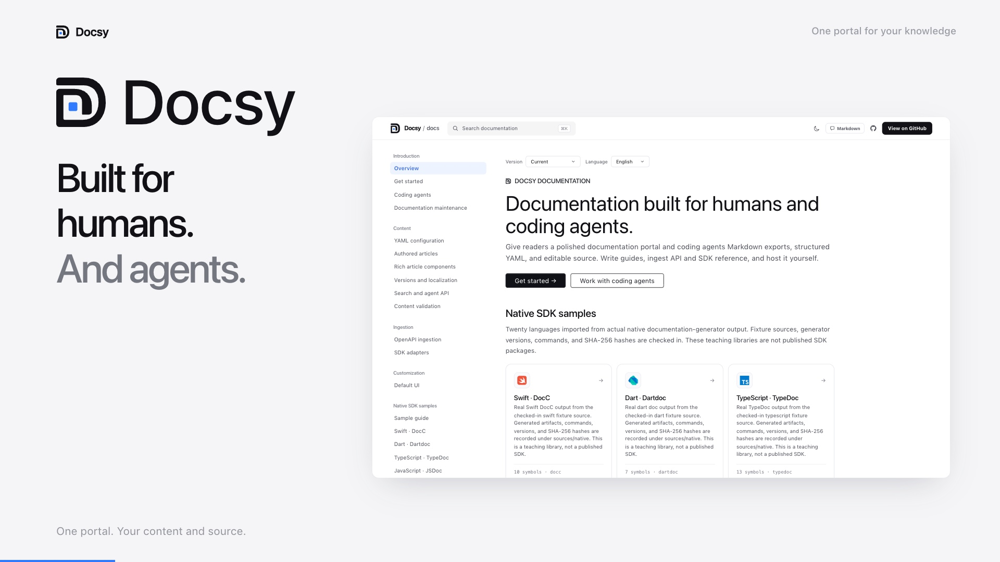
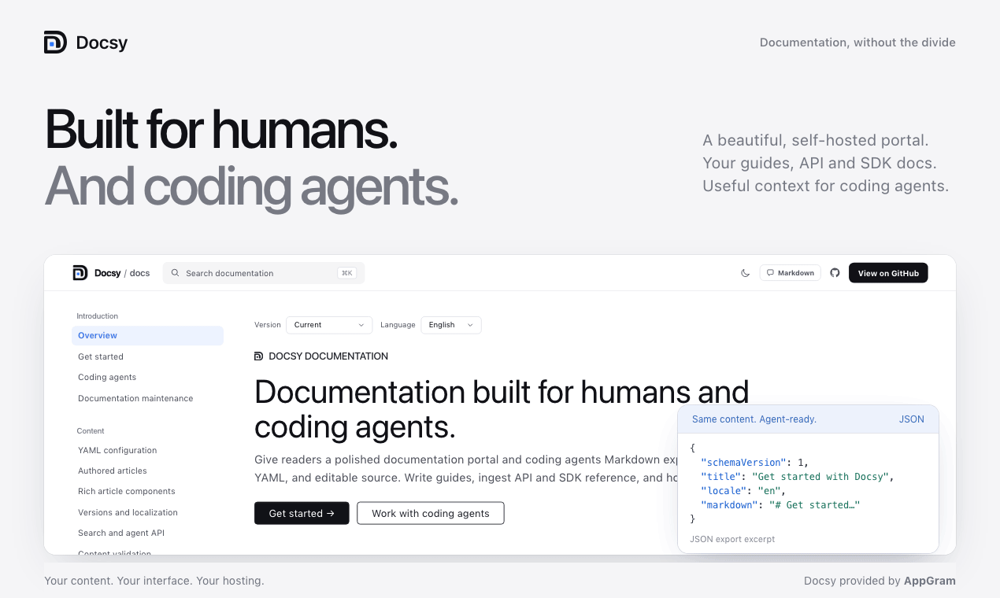
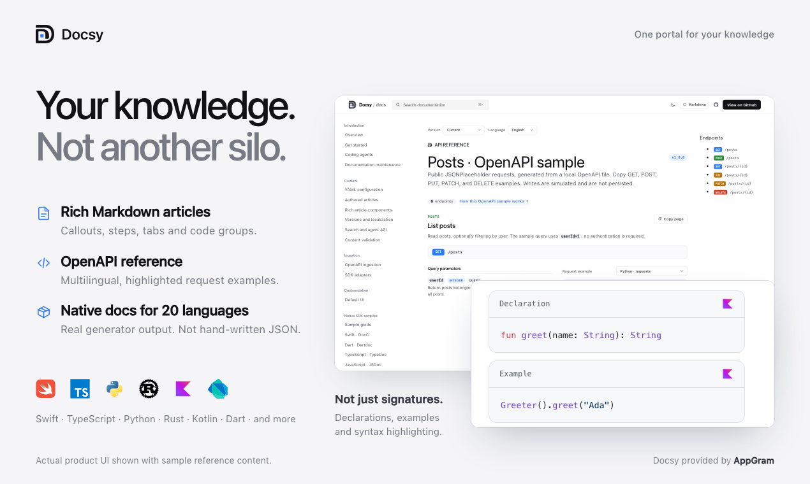
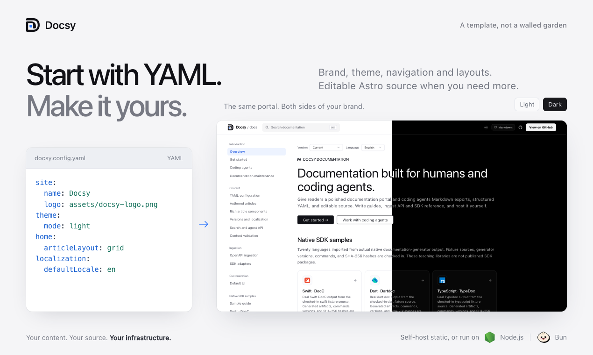
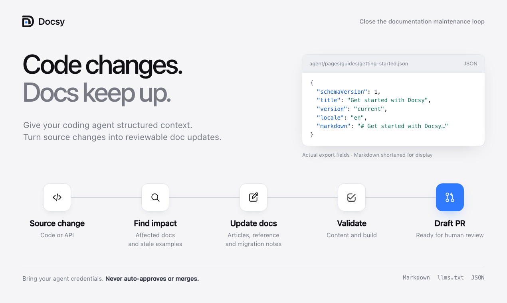
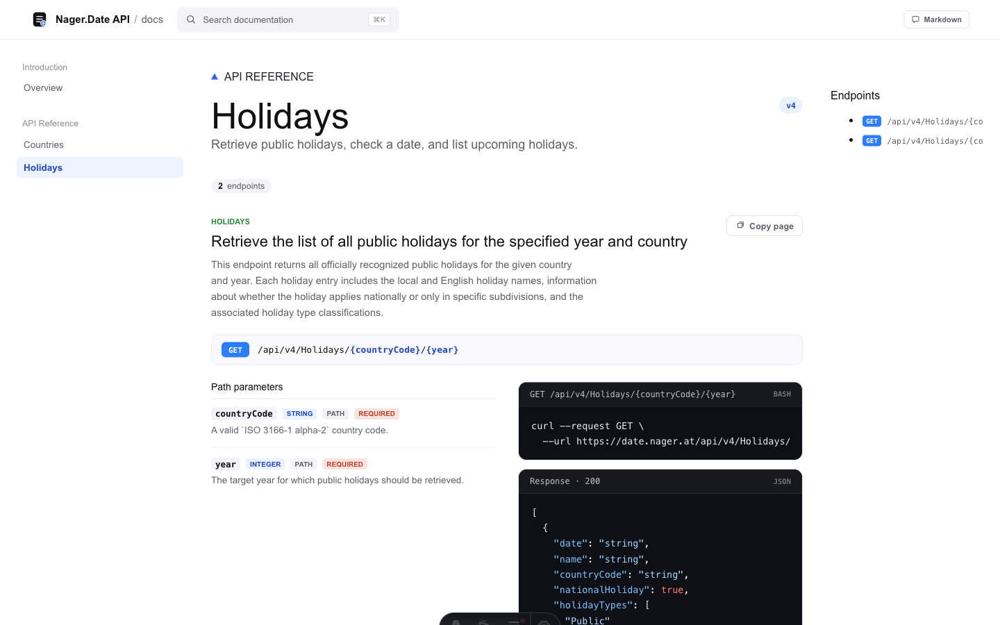
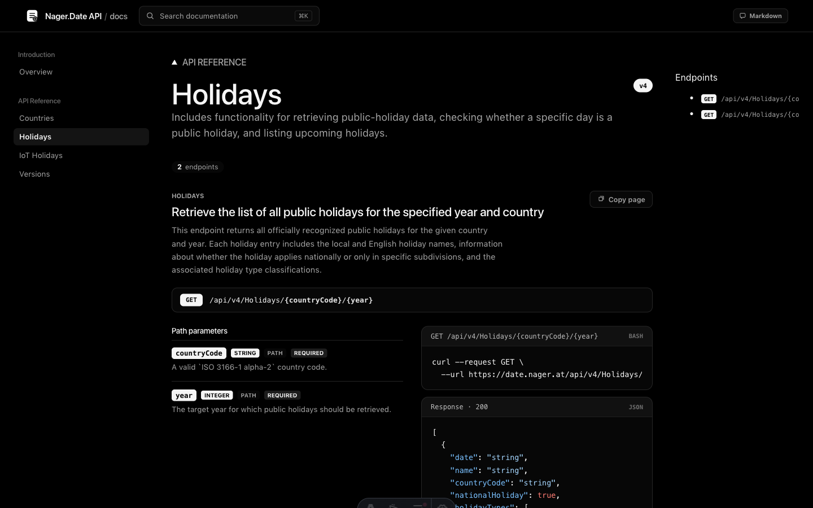
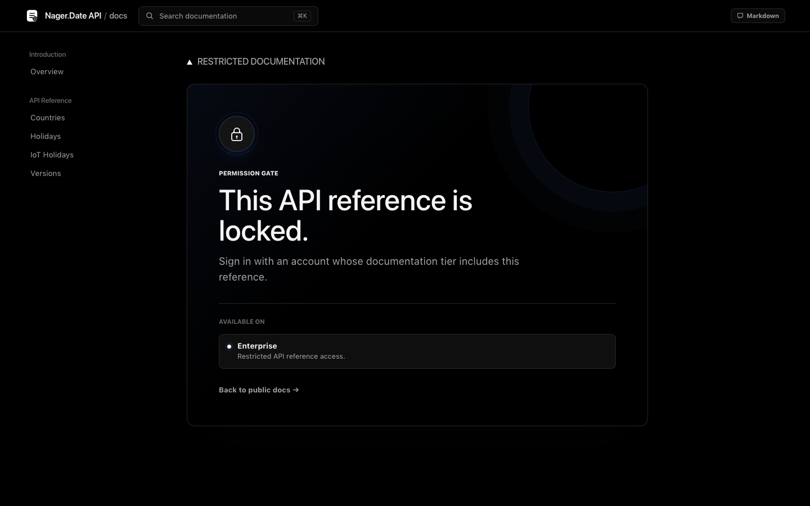

<p align="center">
  <picture>
    <source media="(prefers-color-scheme: dark)" srcset="docs/assets/docsy-logo-dark.png" />
    <source media="(prefers-color-scheme: light)" srcset="docs/assets/docsy-logo.png" />
    
  </picture>
</p>

<h1 align="center">Docsy by AppGram</h1>

<p align="center"><strong>Your documentation. Your source. Your infrastructure.</strong><br />Built for humans and coding agents.</p>

<p align="center"><a href="https://appgram.github.io/docsy/">Documentation</a> · <a href="content/getting-started.md">Getting started</a> · <a href="https://github.com/AppGram/docsy/issues">Issues</a></p>

> Public, source-available repository under ELv2. The `@appgram/docsy@0.4.0` npm release candidate is prepared but not published yet. Use the bundled CLI or a local tarball today. The separate [npm release workflow](docs/npm-release.md) verifies the actual installed package and requires explicit publication approval; pushing to main or deploying Pages does not publish to npm.

Docsy by AppGram turns Markdown, MDX, OpenAPI, and native SDK documentation into a self-hosted portal with source you own. Readers get searchable guides and reference pages. Coding agents get Markdown/JSON exports, YAML configuration, and local validation. No hosted control plane is required.

Product copy, navigation, visual tokens, ingestion, and access rules live in `docsy.config.yaml`. The generated Astro components and CSS stay in your repository, alongside `AGENTS.md` and `DOCSY_BRIEF.md` to guide your coding agent.

Docsy can ship as a fully static site or as a server-rendered application with permission-gated documentation tiers and an optional agent query API. Use Node 22.22 or newer for development and builds. The production server can run on Node or Bun 1.3.5 or newer.

> This project is independent of the Hugo theme with a similar name.

## Watch the product tour

[](https://youtu.be/-9HpXcbcjY4)

[Watch the video with narration on YouTube](https://youtu.be/-9HpXcbcjY4) · 73 seconds · 1080p

See the actual interface, Markdown and API/SDK reference, YAML customization, self-hosting, and the documentation maintenance workflow.

## Product Hunt slideshow

<picture>
  <source media="(prefers-reduced-motion: reduce)" srcset="docs/assets/launch/01-humans-and-agents.png" />
  
</picture>

Four launch images, five seconds per slide. Prefer a still image? Open a slide below. SDK scenes use generator-tested teaching fixtures; see the [compatibility evidence and limits](content/reference/compatibility.md).

<details>
<summary>View the four original slides</summary>

### 1. Built for humans and coding agents


### 2. One portal for guides, APIs, and SDKs



### 3. Your configuration, source, and hosting



### 4. Close the documentation maintenance loop



</details>

## For humans and coding agents

For readers, Docsy brings authored guides, API endpoints, and SDK reference together with navigation, search, code examples, and light/dark themes.

For coding agents, the same documentation is available as Markdown. An agent working in the generated repository can update articles, configure ingestion and branding in YAML, or edit the Astro interface. The CLI includes project instructions and a customization brief, and `npm run validate` plus `npm run build` check the result before review.

Docsy also includes a maintenance loop: a committed API or code change triggers an impact report, agent updates to articles and examples, independent validation, and a draft pull request with migration notes and unresolved questions.

Give your coding agent a concrete task:

```text
Read AGENTS.md, DOCSY_BRIEF.md, and docsy.config.yaml.
Use sources/openapi.json to write a first-request guide in content/.
Register it in YAML and add it to the sidebar.
Use the API source for endpoint names, parameters, and examples.
Preserve the existing UI and access rules.
Run npm run validate and npm run build, then summarize the diff.
```

Use `/format-md/...` exports when an agent needs to fetch documentation over HTTP. The Markdown menu exposes the current page's export; `?format=md` opens its Markdown view in the browser. Your chosen coding agent works with the repository, and you review and publish its changes through your normal Git workflow.

See [Work with coding agents](content/tutorials/coding-agents.md) for both reading and authoring workflows.

Agents can also discover `/llms.txt`, download the full-text corpus at `/agent/index.json`, or read a page as JSON at `/agent/pages/guides/getting-started.json`. Prefix these paths with your configured `site.basePath`. JSON documents include Markdown and citation URLs.

For live retrieval, enable the server-only endpoint on Node or Bun:

```yaml
agent:
  enabled: true
  query: true
  maxResults: 10
  maxQueryLength: 500
```

```bash
curl 'https://docs.example.com/docs/agent/query.json?q=authentication&version=current&locale=en&limit=5'
```

This returns ranked source excerpts and JSON/Markdown links, not a generated answer. It requires no AI provider key. Static deployments retain JSON/Markdown exports but cannot execute query parameters; keep `agent.query: false` for GitHub Pages. In locked mode, every retrieval surface follows the existing page permissions. [Search and agent API guide](content/tutorials/search-and-agents.md).

## Preview

These screenshots show the default interface configured for the public Nager.Date OpenAPI—not AppGram product documentation.

### Light and dark

<table>
  <tr>
    <th width="50%">Light</th>
    <th width="50%">Dark</th>
  </tr>
  <tr>
    <td></td>
    <td></td>
  </tr>
</table>

Both are the same generated OpenAPI page. Switching `theme.mode` and the YAML color tokens changes the presentation without replacing the interface.

### Permission gate



## What Docsy gives you

- An editable Astro project with `AGENTS.md` and `DOCSY_BRIEF.md` for coding agents.
- A YAML-configured maintenance workflow that turns source changes into validated draft documentation PRs.
- OpenAPI 3 and Swagger 2 ingestion from local JSON/YAML or an HTTPS URL.
- Native SDK documentation imports for 20 source languages across 16 generator formats, plus compact metadata and AppGram/docc2json compatibility.
- Real generator-produced fixtures and reproducible larger-library tests (Zod, YAML, Lodash), with source/output hashes. Twenty-language fixtures establish format coverage, not blanket production compatibility. [Evidence and limits](content/reference/compatibility.md).
- Rich native samples with multiple usage examples per language, batch APIs, properties, enum values, optional parameters, remarks, deprecations, and error contracts where supplied by the generator. Every reference reports its actual imported content; all 20 language logos are local SVGs configurable through YAML, including dark variants.
- YAML-selected OpenAPI request examples in 24 language/client targets, synchronized language selection, and custom `x-codeSamples` overrides.
- Generated API pages, navigation, search data, curl examples, response examples, and Markdown exports.
- First-class Markdown and MDX articles, including themed JSX components and explicitly opt-in trusted React imports.
- Theme-aware callouts, numbered steps, synchronized tabs, code groups, accordions, and reusable Markdown snippets.
- Full-text section search across article bodies, examples, API parameters, and SDK symbols.
- Local, build-time syntax highlighting across articles, SDK declarations/examples, and API requests/responses, with language-logo badges and YAML-selectable light/dark palettes. No highlighter CDN or browser runtime is needed.
- YAML-configured versions, locale routing, translated navigation, RTL, and explicit language fallbacks.
- Static JSON/Markdown discovery plus an optional permission-aware JSON query endpoint for coding agents.
- Strict source ingestion, OpenAPI reference/example validation, and internal/built-site link and anchor checks.
- One YAML file for branding, content, navigation, routes, ingestion, theme tokens, and access rules.
- A persisted light/dark theme toggle with independently configurable palettes.
- Open mode for static hosting and lock mode for server-side permission checks.
- Header-based identity for trusted auth proxies or webhook authorization for an existing application.
- Docker and Docker Compose files for a short self-hosting path.
- System font stacks by default: no hosted font service and no generated typographic tracking.
- Optional validation/preview and gated Pages workflows, template-version provenance, non-destructive upgrade comparison, and a bounded local Mintlify importer.
- Configurable article edit/report links carrying the page, version, and locale.
- YAML author profiles, contributor/reviewer credits, explicit article dates and optional coding-agent/model provenance, preserved in Markdown/JSON exports. Per-article GitHub edit links can be overridden or disabled.

## The mental model

```text
Markdown / OpenAPI / SDK metadata
        │
        ▼
 content loaders/adapters ──► normalized docs model
        │
        ▼
 docsy.config.yaml ───► routes, navigation, theme, access rules
        │
        ▼
 editable Astro source
        │
        ├── open mode   ──► static files in release/
        └── locked mode ──► Node/Bun server with request-time authorization
```

The important boundary is simple:

- YAML owns durable configuration and content wiring.
- Astro and CSS own the interface.
- The article loader and ingestion adapters own source-format differences.
- Lock mode owns request-time authorization, not user authentication itself.

Docsy never requires a hosted control plane. A generated project builds and runs from its own repository.

## Documentation

Read the [Docsy documentation portal](https://appgram.github.io/docsy/) or browse the article sources below. This repository powers that portal using its own `content.articles` configuration; you can also build and run the same site locally.

| Article | What it explains |
| --- | --- |
| [Get started with Docsy](content/getting-started.md) | Run the portal, generate a project, and understand the ownership boundary |
| [Work with coding agents](content/tutorials/coding-agents.md) | Read Markdown exports, give an agent a project brief, and validate documentation changes |
| [Maintain documentation automatically](content/tutorials/documentation-maintenance.md) | Detect affected docs, correct stale examples, explain breaking changes, and open validated draft PRs |
| [Configure Docsy with YAML](content/tutorials/yaml-configuration.md) | The configuration lifecycle, top-level sections, paths, and environment values |
| [Write authored documentation](content/tutorials/authored-articles.md) | Markdown articles, YAML registration, navigation, search, exports, and permissions |
| [Rich article components](content/tutorials/rich-articles.md) | Callouts, steps, tabs, code groups, accordions, and reusable snippets |
| [Native MDX articles](content/tutorials/native-mdx.mdx) | YAML registration, themed JSX, trusted component modules, search and agent exports |
| [Full-text search and agent JSON API](content/tutorials/search-and-agents.md) | Static retrieval exports, the optional server query endpoint, and permission filtering |
| [Versions and localization](content/tutorials/versions-and-locales.md) | Stable context URLs, translated UI/navigation, fallbacks, and versioned ingestion |
| [Content validation](content/tutorials/content-validation.md) | Source failures, API linting, schema examples, links, anchors, and component checks |
| [Ingest an OpenAPI document](content/tutorials/openapi-ingestion.md) | Local and remote sources, section matching, and navigation |
| [Ingest SDK documentation](content/ingestion/sdk-adapters.md) | Native artifact formats, 20-language coverage, portable metadata, and bounded private ingestion |
| [Customize the default UI](content/customization/default-ui.md) | YAML brand tokens and the source-owned Astro interface |
| [Protect documentation by tier](content/tutorials/lock-mode.md) | Ordered access rules, trusted headers, webhooks, and locked deployment |
| [Deploy to GitHub Pages](content/deployment/github-pages.md) | Static Pages configuration and the included Actions workflow |
| [Self-host Docsy](content/deployment/self-hosting.md) | Static, Node, and Docker deployment shapes |
| [Understand the Docsy license](content/reference/license.md) | What ELv2 permits, what it prohibits, and how it applies to generated sites |
| [CLI reference](content/reference/cli.md) | Project generation, validation, building, and production startup |
| [Upgrade a customized site](content/reference/upgrading.md) | Template provenance and a review-only comparison that never overwrites source |
| [Migrate from Mintlify](content/tutorials/migrate-mintlify.md) | Supported local exports, assets, redirects, and explicit conversion limits |
| [Compatibility evidence](content/reference/compatibility.md) | Real-library results, reproduction commands, and remaining coverage limits |

## Quick start

Use Node 22.22 or newer. Run Docsy's own documentation portal:

```bash
git clone https://github.com/AppGram/docsy.git docsy
cd docsy
npm ci
npm run dev
```

Open [http://localhost:4321/docsy/](http://localhost:4321/docsy/).

The portal uses the default light interface and renders every registered Markdown article. Its [Posts request sample](https://appgram.github.io/docsy/api/posts/) and [Comments query sample](https://appgram.github.io/docsy/api/comments/) are generated from the committed `sources/samples/jsonplaceholder.openapi.yaml` teaching subset. Copy GET, POST, PUT, PATCH, and DELETE curl examples against JSONPlaceholder; writes are simulated and not persisted. The Nager.Date snapshot remains available as an alternative source. [How the OpenAPI sample is configured](content/tutorials/openapi-ingestion.md).

## Create your own documentation site

From a clone of this public repository with dependencies installed, build a local versioned CLI package:

```bash
npm run release:pack
```

It prints one copyable `npm exec --package "/absolute/path/appgram-docsy-0.4.0.tgz" -- create-docsy my-docs --yes --ci` command. This installs from the local tarball, not a public npm release. Add `--openapi ./my-api.yaml` to bring your own API, or edit the generated Markdown/YAML directly.

After the first npm release is actually published, the equivalent registry command will be:

```bash
npm exec --package @appgram/docsy@0.4.0 -- create-docsy my-docs --yes --ci
```

Release preparation can be checked locally with `npm run test:package`. It packs the real archive, installs it in a clean consumer without checkout dependency links, generates a project using your own OpenAPI and MDX, validates/builds it, and tests both static and locked serving. The result and archive checksum are saved under `.docsy/packages/release/`. See the [release and trusted-publisher checklist](docs/npm-release.md); this command never publishes anything.

To scaffold your own Pages site, add `--deploy github-pages --repo https://github.com/OWNER/REPOSITORY`. The generator derives the correct origin/base path, includes validation and deployment workflows, and prints the expected URL. It **does not** create a repository, push, enable Pages, or deploy. Deployment stays off until you explicitly set `DOCSY_ENABLE_PAGES=true` and enable Pages in your own repository. Locked sites and live queries require Node/Bun instead.

After creation:

```bash
cd my-docs
npm run docsy -- doctor
npm run build
npm run preview
```

The generated `DEPLOYING.md` walks through adding your content, local checks, source storage, the explicit publishing decision, and verifying the resulting URL. The project also records `.docsy/template.json`. Keep it in Git; see the [upgrade guide](content/reference/upgrading.md) before adopting future fixes.

### Generate directly from source

From a clone of this repository:

```bash
npm run create -- ../holiday-docs \
  --yes \
  --name "Holiday API" \
  --openapi ./sources/openapi.json \
  --api-base https://date.nager.at \
  --base /docs

cd ../holiday-docs
npm run dev
```

Use an OpenAPI URL instead of a local file when desired:

```bash
npm run create -- ../my-docs \
  --yes \
  --name "Acme API" \
  --openapi https://api.example.com/openapi.json \
  --api-base https://api.example.com \
  --base /docs \
  --locked
```

Without `--yes`, the CLI asks for the project directory, OpenAPI source, product name, mount path, and access mode. It then:

1. Parses the OpenAPI document.
2. Groups operations into sections using tags and path segments.
3. Copies the editable Astro interface.
4. Writes a validated `docsy.config.yaml`.
5. Copies local ingestion sources into `sources/`.
6. Adds `AGENTS.md` and `DOCSY_BRIEF.md` for safe AI-assisted customization.
7. Installs dependencies unless `--no-install` is supplied.

Run `node scripts/create-docsy.mjs --help` for every option.

## Close the documentation maintenance loop

Generated projects include a GitHub workflow and a local maintenance command. Enable the workflow through YAML:

```yaml
maintenance:
  enabled: true
  watch: [sources/**, src/**]
  docs: [content/**/*.md, README.md]
  breakingChangesFile: content/maintenance/breaking-changes.md
```

Add the `OPENAI_API_KEY` Actions secret and allow GitHub Actions to create pull requests. On a default-branch source change, the workflow compares revisions, finds likely affected docs and stale examples, and runs Codex to prepare updates. A fresh job checks the allowed diff and runs validation and the production build. A final job opens a draft PR on a dedicated branch. Empty updates produce no PR; a failed check stops publication.

Inspect or run it locally:

```bash
npm run maintain -- plan --base HEAD~1
npm run maintain -- run --base HEAD~1
# With authenticated gh, also create and push a draft PR:
npm run maintain -- run --base HEAD~1 --pr
```

The planner compares local OpenAPI and Swagger contracts, flags likely breaking changes, and maps changed paths and symbols to Markdown articles. The agent uses the source diff to update guides and explain migrations. Use committed snapshots to track remote ingestion changes; the workflow reacts to Git changes rather than polling upstream URLs. [Setup, scope, and review details](content/tutorials/documentation-maintenance.md).

The checked-in [evidence bundle](docs/evidence/README.md) includes a real Zod v3/v4 error-contract change: an actual agent update, executed assertion against the corrected example, independently validated build, and reviewable patch/PR body. That demonstration did not create a remote PR or hosted preview. Static CI updates attach a downloadable rendered preview artifact; locked/server builds do not expose their bundle as static content.

## Configure it with YAML

`docsy.config.yaml` is the source of truth for the generated site:

```yaml
site:
  name: Acme API
  title: Acme API Documentation
  origin: ${DOCSY_ORIGIN:-http://localhost:4321}
  basePath: /docs
  logo: assets/docsy-mark.svg

theme:
  mode: dark
  colors:
    ink: "#f5f5f5"
    muted: "#a3a3a3"
    line: "#262626"
    paper: "#000000"
    accent: "#ffffff"
  fonts:
    display: '"Aptos Display", "SF Pro Display", "Helvetica Neue", sans-serif'
    body: '"Aptos", "SF Pro Text", "Helvetica Neue", sans-serif'
    mono: 'ui-monospace, "SF Mono", Menlo, monospace'

content:
  articles:
    - slug: getting-started
      source: content/getting-started.md
      title: Getting started
      description: Make your first authenticated request.
      eyebrow: GUIDE

navigation:
  - title: API Reference
    items:
      - title: Users
        href: /api/users

ingestion:
  sdks: []
  openapi:
    enabled: true
    source: sources/openapi.yaml
    apiBaseUrl: https://api.example.com
    sections:
      - section: users
        title: Users
        description: Create and manage users.
        tags: [users]
        paths: [/users]
```

`${ENV_NAME}` and `${ENV_NAME:-fallback}` placeholders are expanded before validation. Set `DOCSY_CONFIG` to use a different YAML file without changing source.

Configuration errors fail with their exact YAML path. Run this before committing:

```bash
npm run validate
```

## Authored Markdown and MDX articles

Docsy can render documentation you write directly; OpenAPI and SDK ingestion are optional companions, not the only content model.

Create a Markdown file outside `public/`:

```text
content/guides/authentication.md
```

Register it in YAML:

```yaml
content:
  articles:
    - slug: authentication
      source: content/guides/authentication.md
      title: Authentication
      description: Create a token and authenticate API requests.
      eyebrow: GUIDE

navigation:
  - title: Guides
    items:
      - title: Authentication
        href: /guides/authentication
```

Docsy serves it at `/guides/authentication` underneath `site.basePath`. Nested slugs such as `platform/security/authentication` create nested guide URLs. Level-two and level-three headings populate the page rail.

Authored articles automatically participate in navigation, search, Markdown export, and lock-mode permission rules. Keep protected Markdown outside `public/`, because files under `public/` are served as unprotected static assets.

Use a `.mdx` source in the same YAML registration to write native MDX. Built-in `<Note>`, `<Tabs>`, `<Steps>`, `<CardGroup>`, `<Accordion>` and `<CodeGroup>` components use Docsy's current theme, highlighting and client controls. Mintlify migration preserves supported MDX by default rather than flattening it to Markdown.

```yaml
content:
  mdx:
    enabled: true
    allowJavaScript: false
    components: {}
  articles:
    - slug: overview
      source: content/overview.mdx
      title: Overview
```

Declarative mode permits literal props such as `cols={2}` but rejects executable expressions, imports, unknown components and unsafe markup. For reviewed code only, set `allowJavaScript: true` and optionally map `components: { ApiStatus: content/components/ApiStatus.tsx }`. These default-export React modules and local MDX imports run during validation/build/server rendering with process permissions; they are **not sandboxed or automatically hydrated**. The maintenance agent remains restricted to Markdown/guarded YAML, not executable MDX. [Full authoring and compatibility guide](content/tutorials/native-mdx.mdx).

### Authors and GitHub editing

Register profiles once, then reference them on articles. Author GitHub profiles do not automatically enable repository editing; that is an explicit site or per-page choice.

```yaml
authors:
  alex:
    name: Alex Morgan
    github: your-github-username
    avatar: assets/authors/alex.png
reader:
  showByline: true
  defaultAuthorAvatar: assets/authors/unknown.svg
  unknownAuthorAvatar: assets/authors/unknown.svg
  editEnabled: true
  editUrl: https://github.com/OWNER/REPOSITORY/edit/main/{source}
content:
  articles:
    - slug: authentication
      source: content/authentication.md
      title: Authentication
      authors: [alex]
      updatedAt: '2026-10-19'
```

Individual `avatar` pictures override the optional `reader.defaultAuthorAvatar`. Set `reader.unknownAuthorAvatar` to show an “Unknown author” picture on articles with no authors; omit it to leave those bylines absent. Use local images in `public/assets/` or explicit HTTP(S) URLs; Docsy never fetches GitHub profile pictures automatically.

Use `editUrl: false` on an article to hide its edit button, or provide another edit URL. Optional `contributors`, `reviewedBy`, dates and agent/model provenance are documented in [Authors, reviews and edit links](content/tutorials/authors-and-edit-links.md). Attribution is configured, not an automatically verified authorship or quality score. `reader.showByline: false` hides the visual byline; it does not erase metadata from machine-readable exports.

### Image and video viewer

Article images can open fullscreen; videos retain inline controls and offer an expand button. The theme-aware viewer includes image zoom, captions, previous/next controls, native video playback and captions, and Escape-to-close with focus restoration. It uses no third-party player or tracking scripts.

```yaml
content:
  media:
    enabled: true
    images: true
    videos: true
```

All three default to `true`. Set `enabled: false` to disable the viewer or disable either media type independently. Use `data-docsy-media="off"` on individual HTML/MDX media or figures to opt out. Linked images and decorative UI icons retain their original behavior. [Authoring examples and public/protected-media boundaries](content/tutorials/rich-articles.md#images-and-videos).

## OpenAPI ingestion

`ingestion.openapi.source` accepts:

- A project-relative `.json`, `.yaml`, or `.yml` file.
- An `http://` or `https://` URL fetched during the build.

The adapter handles Swagger 2 and OpenAPI 3 parameters, request bodies, response content, component schemas, examples, and security declarations. Each configured section matches operations by tag substring, path substring, or both.

For deterministic, private, or air-gapped builds, commit a spec snapshot under `sources/`. Do not place a protected specification under `public/`; files there bypass lock-mode middleware.

## SDK ingestion adapters

Every adapter normalizes its input into the same internal `SDKDoc` model. Rendering, search, and Markdown export therefore do not need to know which documentation generator produced the source.

| Adapter | Input shape | Typical source |
| --- | --- | --- |
| `typedoc-lite` | `modules[0].types` plus `navigation.categories` | Language-neutral compact metadata, including React/React Native |
| `swift-symbols` | Types, protocols, enums, and navigation categories | [AppGram/docc2json](https://github.com/AppGram/docc2json) output from DocC archives |
| `typedoc`, `jsdoc` | TypeDoc JSON / JSDoc doclets | TypeScript, JavaScript |
| `sphinx`, `javadoc`, `dokka`, `scaladoc` | Native JSON-builder / HTML artifacts | Python, Java, Kotlin, Scala 2 |
| `docfx` | ManagedReference YAML from compiler assemblies + XML | C#, F#, Visual Basic |
| `doxygen` | Native XML directory | C, C++, Objective-C |
| `godoc`, `rustdoc`, `docc` | `go doc -all` text / stable rustdoc HTML / DocC render JSON | Go, Rust, Swift |
| `dartdoc`, `phpdoc`, `yard`, `exdoc`, `ldoc` | Native HTML or XML artifacts | Dart, PHP, Ruby, Elixir, Lua |

```yaml
ingestion:
  sdks:
    - id: javascript
      slug: javascript-sdk
      adapter: typedoc
      source: sources/javascript/docs.json
      name: JavaScript SDK
      language: typescript
      install: npm install @acme/sdk
      overview: Typed client for the Acme API.
      icon: assets/sdks/javascript.svg
```

Source paths are resolved from the project root.

The portal uses original output generated from `tests/generators/input/`, with versions, commands, source hashes, and output hashes in `sources/native/provenance.json`. `npm test` verifies all 20 fixtures. Regenerate with `npm run fixtures:image` followed by `npm run fixtures:generate`; generators are not required to consume committed output. Native inputs remain outside `public/`, bounded by YAML file/byte limits; scripts, pickle/Marshal data, XML entities, and symlinks are not executed or followed. F# DocFX output may provide C# declarations, which are labeled C#. HTML selectors target the recorded generator versions. [Exact coverage and reproduction](content/ingestion/sdk-samples.md).

### Multilingual OpenAPI requests

```yaml
ingestion:
  openapi:
    enabled: true
    source: sources/openapi.yaml
    apiBaseUrl: https://api.example.com
    examples:
      languages: [curl, javascript, typescript, python, go, java, kotlin, csharp, rust, swift, dart]
      defaults: required
      customSamples: true
```

The native select remembers the reader's choice across endpoint cards and pages. Auth headers, path/query values, and JSON request bodies come from the same normalized request. `x-codeSamples` can replace generated examples for a selected language with actual SDK calls. All configured samples also reach Markdown and agent exports. [Options and supported request targets](content/tutorials/openapi-ingestion.md).

## Permission-gated lock mode

Open mode is the static default:

```yaml
access:
  mode: open
```

Locked mode uses Astro's standalone server adapter, runs on Node or Bun, and evaluates ordered access rules on every protected request:

```yaml
access:
  mode: locked
  provider:
    type: header
    tierHeader: x-docsy-tiers
    userHeader: x-docsy-user
  tiers:
    developer:
      label: Developer
    enterprise:
      label: Enterprise
      description: Restricted platform operations.
  rules:
    - pattern: /api/license-keys
      tiers: [enterprise]
    - pattern: /api/**
      tiers: [developer, enterprise]
  gate:
    title: This API reference is locked.
    description: Sign in with an account that can access this reference.
    loginUrl: https://app.example.com/login
    loginLabel: Sign in to continue
```

Rules are evaluated from top to bottom. `*` matches one path segment; `**` matches any number of segments. The same rules protect rendered pages and Markdown exports, and search results are filtered to the visitor's tiers.

### Trusted-header provider

Use this behind Cloudflare Access, oauth2-proxy, an ingress gateway, or your own authentication proxy. The proxy must:

1. Remove client-supplied copies of the identity headers.
2. Authenticate the visitor.
3. Set the trusted tier and optional user headers.
4. Prevent visitors from reaching Docsy around the proxy.

Tier values may be comma- or space-separated.

### Webhook provider

If authorization belongs in your application:

```yaml
access:
  mode: locked
  provider:
    type: webhook
    endpoint: https://app.example.com/internal/docsy/authorize
    method: POST
    forwardHeaders: [cookie, authorization]
    pathHeader: x-docsy-path
    timeoutMs: 3000
```

The endpoint returns:

```json
{
  "authenticated": true,
  "subject": "user_123",
  "tiers": ["developer"]
}
```

Timeouts, errors, and non-2xx responses fail closed.

## Customize the interface

Start with YAML for branding and stable tokens. Edit source when the request is truly about layout or behavior:

| Concern | File |
| --- | --- |
| Product, routes, colors, fonts, access | `docsy.config.yaml` |
| Shell, header, search, mobile navigation | `src/layouts/DocsLayout.astro` |
| API and SDK presentation | `src/components/docs/` |
| Base design primitives | `src/styles/docsy.css` |
| YAML validation and path helpers | `src/config.ts` |
| OpenAPI normalization | `src/lib/swagger-loader.ts` |
| SDK normalization | `src/lib/sdk-loaders.ts` |

Generated projects include a customization brief for coding agents. Its rule is deliberate: preserve the working reference interface by default, use YAML for configuration, and touch Astro/CSS only for an explicitly requested UI change.

## Self-hosting

### Docker Compose

This is the shortest path for both access modes:

```bash
docker compose up --build
```

Open [http://localhost:8080/docs/](http://localhost:8080/docs/).

The container detects the build type automatically. Open mode with `agent.query: false` serves staged static files; locked mode or `agent.query: true` starts the Astro Node server. The runtime image includes authored content and snippets as well as ingestion sources.

### Static host

For `access.mode: open`:

```bash
npm ci
npm run build
```

Publish `release/` as the web root. The configured `site.basePath` is already staged underneath it, and `release/index.html` redirects to that mount path.

Any conventional static server, object storage website, or CDN can host this output.

### GitHub Pages

The public documentation portal is hosted at [appgram.github.io/docsy](https://appgram.github.io/docsy/). Main-branch CI in `.github/workflows/checks.yml` invokes `.github/workflows/pages.yml` only after validation succeeds and `DOCSY_ENABLE_PAGES=true`. The Pages workflow validates and builds the open-mode portal, uploads `dist/`, and deploys it through the `github-pages` environment. It can also be run manually from Actions.

For your own repository, select **GitHub Actions** as the Pages source and set the repository Actions variable `DOCSY_ENABLE_PAGES` to `true`. This publishes documentation only; it does not publish an npm package or create a GitHub release. The generated workflows keep this deployment gate off until you enable it.

For a repository site, set `site.origin` to the GitHub Pages host and `site.basePath` to the repository name. The Docsy portal uses `https://appgram.github.io` and `/docsy`.

### Node or Bun server

For `access.mode: locked`:

```bash
npm ci
npm run build
HOST=0.0.0.0 PORT=8080 npm run preview
```

Put the process behind the trusted authentication proxy described above. Rebuild after changing `access.mode`, `site.basePath`, or ingestion configuration.

To run the same build on Bun instead:

```bash
HOST=0.0.0.0 PORT=8080 npm run start:bun
# Equivalent: bun scripts/start.mjs
```

`start:bun` serves both public static output and the Astro standalone server used for lock mode and live agent queries. Node remains the build toolchain; this is Bun **production runtime** support, not a claim that all development/build tools or the test runner execute on Bun. The integration suite runs actual static, locked, and agent-query requests on Bun 1.3.5, including unauthorized retrieval checks.

For a Node-build/Bun-runtime container:

```bash
docker build -f Dockerfile.bun -t docsy-bun .
docker run --rm -p 8080:8080 docsy-bun
```

The default `Dockerfile` and Compose service continue to use Node. Both Dockerfiles are included in generated projects. Bun runtime regression checks run with `npm run test:runtime:bun` and in the dedicated CI job.

## Commands

| Command | Purpose |
| --- | --- |
| `npm run dev` | Start Astro development mode |
| `npm run validate` | Validate YAML, sources, API examples, components, links, anchors, and Astro types |
| `npm run build` | Validate, build, and stage production output |
| `npm run preview` | Serve the staged static build or locked Node build |
| `npm start` | Start the production build with Node |
| `npm run start:bun` | Start the same production build with Bun |
| `npm run create -- <dir>` | Generate a new editable project |
| `npm run maintain -- plan --base <ref>` | Inspect source changes and documentation impact |
| `npm run maintain -- run --base <ref>` | Update docs with the agent and validate the result |
| `npm test` | Run content, ingestion, MDX, maintenance, theme and production-runtime regression tests |
| `npm run release:pack` | Audit and pack a local npm release candidate without publishing |
| `npm run test:package` | Install the actual tarball, generate content, build and test static/locked serving |

## Project structure

```text
.
├── docsy.config.yaml       # Product, theme, ingestion, navigation, access
├── content/                # Authored Markdown articles
├── sources/                # Build-time OpenAPI and SDK inputs, not public web assets
├── public/                 # Public assets only
├── src/
│   ├── components/docs/    # API and SDK UI
│   ├── layouts/            # Documentation shell
│   ├── lib/                # Ingestion, access, Markdown export
│   ├── pages/              # Generated routes
│   └── styles/             # Source-owned styling
├── scripts/                # CLI, build staging, runtime launcher
├── Dockerfile
└── compose.yaml
```

## Contributing

Issues and pull requests are welcome. Before submitting a change:

```bash
npm ci
npm test
npm run validate
npm run build
```

Please preserve the configuration/source boundary, keep permission checks server-side, and avoid external font services or typographic tracking.

Pull requests targeting `main` automatically run the Node test suite and production build, real-library generator/import checks, Bun runtime integration tests, and a clean installed-tarball end-to-end test. CI installs Bun 1.3.5 alongside Node 22. Successful open/static builds attach a seven-day `docsy-static-preview-…` artifact; download it and serve its mount-aware directory locally. It is not a public preview URL. Locked/server output is never uploaded as a static preview.

The combined **PR checks** job passes only if all four jobs succeed. No secrets, write token, automatic approval or merge are used for PR validation. Automatic Pages deployment runs only after successful main-branch CI with `DOCSY_ENABLE_PAGES=true`; it is enabled for this repository's public documentation portal. npm publication uses a separate manual workflow, repository gate and typed confirmation, not the Pages switch. Enforcing the combined check as a merge requirement additionally depends on the repository's branch rules.

Contributions are distributed under ELv2. By submitting a pull request, you confirm that you have the right to contribute the code under those terms. See [CONTRIBUTING.md](CONTRIBUTING.md) for the complete project contribution guidance.

## License

Docsy is **source-available**, not OSI-approved open-source software. It is licensed under the [Elastic License 2.0](LICENSE) © AppGram.

### You may

- Self-host Docsy for your own public, private, personal, or commercial documentation.
- Configure and modify the YAML, Markdown, Astro components, styles, adapters, and runtime.
- Replace or remove visible Docsy and AppGram branding from your documentation pages, including the default footer and logo.
- Copy, redistribute, and publish modified versions when you include ELv2 and clearly state that you changed the software.
- Hire a consultant to configure or deploy Docsy for you.
- Keep your Markdown, OpenAPI files, SDK metadata, branding, and other documentation content under terms of your choosing.

### You may not

- Offer Docsy to third parties as a hosted or managed documentation service that exposes a substantial set of Docsy's features.
- Rebrand Docsy as your own competing SaaS documentation builder and charge customers to access it.
- Remove or hide the `LICENSE` terms or copyright notices from the Docsy software or copies you redistribute.
- Circumvent license-key functionality or protected features if Docsy adds them.

ELv2 does not require a visible "Powered by Docsy" or "Docsy provided by AppGram" notice on your published documentation. It does require the legal notices to remain with the software. ELv2 also does not require you to publish private modifications or prohibit commercial activity generally: consulting, integration, and using Docsy for a commercial product's own documentation remain allowed. The restriction is providing Docsy itself as a hosted or managed service. The [license text](LICENSE) controls if this summary and ELv2 differ.
