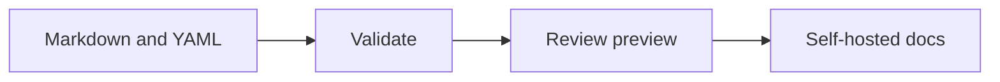
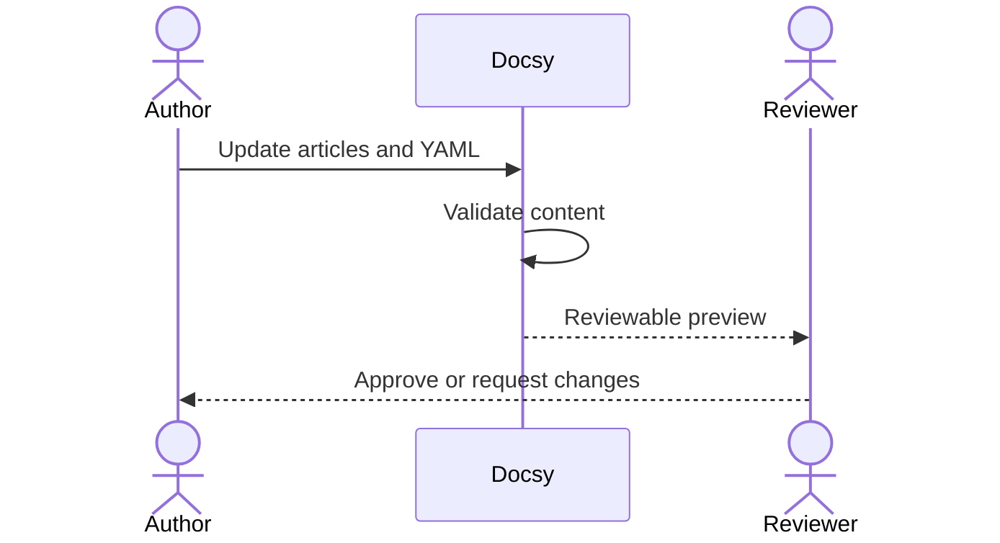
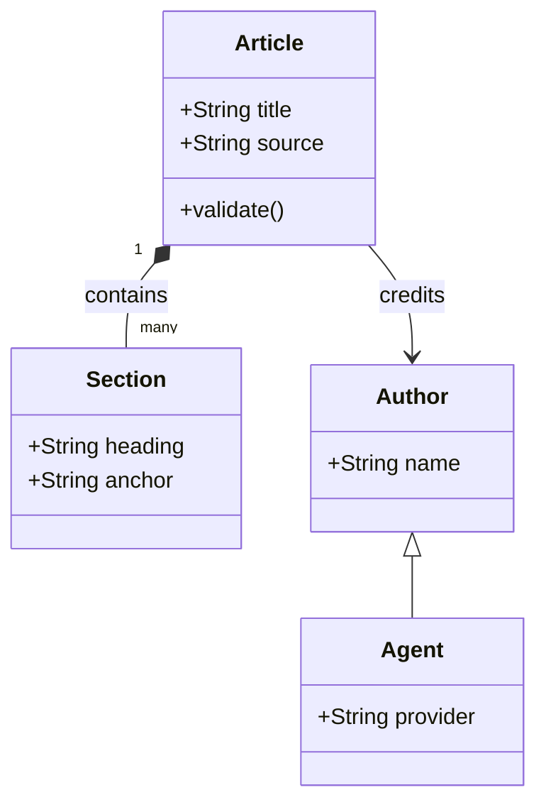
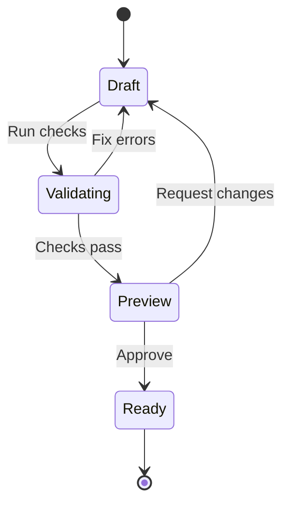

Write Mermaid diagrams directly in Markdown or MDX code fences. Use Mermaid's class, sequence and state notation for UML, or embed an SVG/PNG exported by PlantUML with its editable `.puml` source. No diagram source is sent to a public renderer.

## Mermaid flowcharts

Use a `mermaid` fence. The optional text after the language becomes the caption and accessible image description. Describe the important relationship in surrounding prose so both readers and coding agents understand it.

````markdown

````


The renderer is bundled locally and loaded only on pages containing Mermaid diagrams. Diagrams follow Docsy's current light/dark palette and existing font stack. Click the diagram to open the fullscreen zoom/pan viewer. Expand **Diagram source** to inspect or copy the original notation.

## UML sequence diagrams

An author submits a change to Docsy, which validates it and produces a preview for a reviewer. The reviewer makes the final decision; generating a preview does not publish the change.



## UML class diagrams

An article contains sections and credits one or more authors. An agent is a kind of author with explicit provider metadata, not an automatic proof of correctness.



## UML state diagrams

A failed validation returns a draft to editing. Only a reviewed preview is ready for a separate deployment step.



## Configure Mermaid through YAML

Merge this into your existing configuration:

```yaml
content:
  mermaid:
    enabled: true
    maxTextSize: 50000
    maxEdges: 500
    sourceLabel: Diagram source
    errorLabel: This diagram could not be rendered. Check its source below.
```

These are the defaults. `enabled: false` leaves Mermaid fences as ordinary source code and does not load the Mermaid renderer. `maxTextSize` is a per-diagram character limit; `maxEdges` is passed to Mermaid's graph renderer. Docsy validates the source safety rules and size during validation/build. Mermaid grammar/layout is evaluated in the reader's browser; a syntax or layout error displays a message and keeps the copyable source visible instead of hiding it.

The renderer fixes Mermaid to strict security settings. Diagram-local configuration directives and frontmatter, resource URLs, external images and font loading are rejected. Set site-wide appearance through Docsy's theme configuration, not Mermaid `init` directives or `themeCSS`.

## PlantUML exports

The following preview was generated from a real `.puml` source with PlantUML 1.2026.9. The preview and source download remain inside this article's access boundary.

::plantuml{src="article-review"}

Register a local SVG or PNG export and optional source:

```yaml
content:
  diagrams:
    article-review:
      format: plantuml
      image: content/diagrams/article-review.svg
      source: content/diagrams/article-review.puml
      alt: Author submits documentation to Docsy for validation and a reviewer decides whether to approve it.
      caption: A PlantUML sequence diagram with downloadable source.
      background: light
```

Embed it with `::plantuml{src="article-review"}` in Markdown or `<PlantUml src="article-review" />` in MDX. No imports or executable MDX are required. When using an explicit `content.components` list, include `plantuml` to enable the component.

Export locally using your trusted PlantUML installation, for example:

```sh
java -DPLANTUML_SECURITY_PROFILE=SANDBOX -jar plantuml.jar -tsvg content/diagrams/article-review.puml
```

Store protected exports and originals under `content/`, not `public/`. SVG exports must be self-contained: scripts, handlers, external resources and external fonts are rejected. PNG exports are supported as well. The export preserves its chosen palette; set `background` to match that export rather than expecting a light export to automatically become a dark one.

Docsy does **not** run raw PlantUML fences or `.puml` preprocessors, execute Java, resolve `!include` directives or contact a PlantUML server. Re-export the SVG/PNG after changing its source. For diagrams rendered directly from editable text, use the Mermaid examples above.

## Search, agent exports and restricted docs

Mermaid notation remains intact in Markdown/JSON exports and participates in full-text search. PlantUML exports contribute their description and caption instead of image data. JavaScript-disabled readers can still read Mermaid source and view PlantUML exports.

Both integrations use the article's existing access rules. Mermaid notation is delivered with the article, not through a separate public data endpoint. PlantUML image/source data is embedded in the authorized article. Do not put protected diagram sources in `public/`, which bypasses authorization.

See [draw.io diagrams](/guides/tutorials/drawio-diagrams) for the existing export-based integration and [native MDX](/guides/tutorials/native-mdx) for article authoring.
