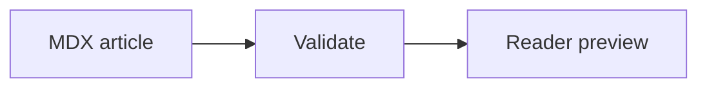

MDX is a first-class article source, alongside Markdown. This page is itself rendered from `content/tutorials/native-mdx.mdx`: the cards, tabs, steps, callouts and code below are live MDX, not screenshots or converted JSON.

## Register an MDX article

Keep the file outside `public/` and register it in `docsy.config.yaml`, exactly like a Markdown article:

```yaml
content:
  mdx:
    enabled: true
    allowJavaScript: false
    components: {}
  articles:
    - slug: getting-started
      source: content/getting-started.mdx
      title: Getting started
      description: Install and configure your project.
```

YAML owns the title, route, version and locale. Optional YAML frontmatter is accepted in `.mdx` sources but does not override registration metadata. `.md` files continue to use Docsy's Markdown directives; `.mdx` files use JSX components.

<Note title="Same content pipeline">
MDX participates in the heading rail, full-text search, Markdown/JSON exports, version and locale selection, and permission gates. Agent exports contain the rendered component text and code, not raw JSX or import statements.
</Note>

## Components that match your theme

These built-ins need no imports. They inherit the existing light/dark palette and local font stacks.

<CardGroup cols={2}>
  <Card title="Bring your articles" href="/guides/tutorials/migrate-mintlify">
    Keep supported Mintlify `.mdx` articles as MDX, with navigation, links and assets mapped into Docsy.
  </Card>
  <Card title="Keep plain Markdown" href="/guides/tutorials/rich-articles">
    Existing articles and directive components continue to work. Mix both formats in one portal.
  </Card>
</CardGroup>

<Tabs group="mdx-runtime">
  <Tab title="Node">

```bash Node
npm install
npm run validate
npm run build
```

  </Tab>
  <Tab title="Bun">

```bash Bun
bun install
bun run validate
bun run build
```

  </Tab>
</Tabs>

<Steps>
  <Step title="Write the article">
    Use Markdown headings, links, GFM tables and fenced examples together with JSX components.
  </Step>
  <Step title="Register the source">
    Add the `.mdx` path under `content.articles` and choose its position in `navigation`.
  </Step>
  <Step title="Validate and preview">
    Run the same validation and build commands as the rest of your documentation. Review the rendered result before deployment.
  </Step>
</Steps>

<Accordion title="Available built-ins">

| Component | Purpose |
| --- | --- |
| `Note`, `Info`, `Tip`, `Check`, `Warning`, `Danger` | Theme-aware callouts, with optional `title` |
| `Tabs`, `Tab` | Keyboard-accessible tabs; use `title` on each tab and `group` or `sync` on the container |
| `Steps`, `Step` | Numbered steps with optional titles |
| `Accordion`, `AccordionGroup` | Expandable sections; `defaultOpen` opens a section initially |
| `CodeGroup` | Tabbed fenced examples; fence metadata supplies the tab label |
| `Card`, `CardGroup` | Linked content cards; the group accepts one to three `cols` |
| `Frame` | A bordered figure wrapper |

Use `content.components` to enable the corresponding groups: `note`, `tip`, `warning`, `danger`, `tabs`, `steps`, `accordion`, `code-group`, `card`, and `frame`. All are enabled by default. Mintlify's icon names, platform integrations and all layout-specific props are not reproduced; supported components use Docsy's UI.

</Accordion>

## Declarative by default

Mermaid fences also work in declarative MDX, including UML notation:



Registered PlantUML exports need no imports: use `<PlantUml src="article-review" />`. See [Mermaid and UML diagrams](/guides/tutorials/mermaid-and-uml) for YAML, sequence/class/state examples and the export boundary.

With `allowJavaScript: false`, Docsy accepts built-in components, a bounded set of ordinary HTML tags, quoted attributes, and literal values such as `cols={2}`. It rejects imports/exports, function calls, variable expressions, attribute spreads, event handlers and executable HTML. Unknown components fail instead of dropping their content. JSX must be valid MDX: close tags, and use JSX comments (`{/* comment */}`), not HTML comments.

This is a restricted authoring mode, not a sandbox for arbitrary JavaScript. Imported source is parsed and checked without executing it.

## Trusted JavaScript and custom components

For a repository whose executable content you trust, opt in explicitly:

```yaml
content:
  mdx:
    enabled: true
    allowJavaScript: true
    components:
      ApiStatus: content/components/ApiStatus.tsx
```

The registered module must export a default React component:

```tsx ApiStatus.tsx
export default function ApiStatus({ children }) {
  return <strong>{children}</strong>;
}
```

Use `<ApiStatus>Available</ApiStatus>` in MDX, or use standard local ESM imports directly in the article. Local `.js`, `.jsx`, `.ts`, `.tsx` and `.mdx` modules are bundled on the server. Keep component files under `content/` so the standard Docker images include them.

<Warning title="Executable content has your process permissions">
Trusted MDX runs during validation, builds and server-side rendering. Imports and expressions can access files, environment variables and the network. Never enable this for unchecked exports, reader submissions, or agent-generated code. Secrets are not protected from trusted MDX. The maintenance workflow remains restricted to Markdown and guarded YAML; it does not automatically edit `.mdx` files.
</Warning>

MDX is rendered to HTML on the server or at build time. React components do not receive automatic browser hydration: hooks requiring a browser, React event handlers and arbitrary interactive widgets are not supported by this renderer. Docsy's built-in tabs, code-copy controls and accordions use its existing client behavior. Root-relative article links and assets respect `site.basePath`.

Set `content.mdx.enabled: false` to reject MDX entirely. [Migrate from Mintlify](/guides/tutorials/migrate-mintlify) to test your existing source without enabling JavaScript.
